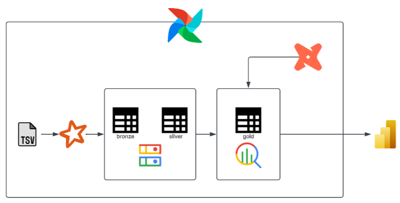
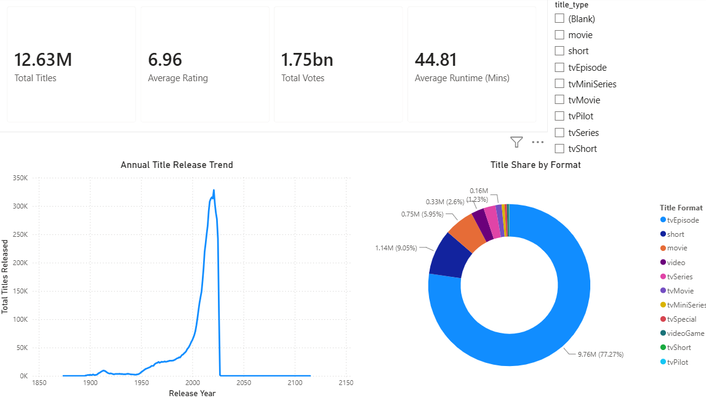
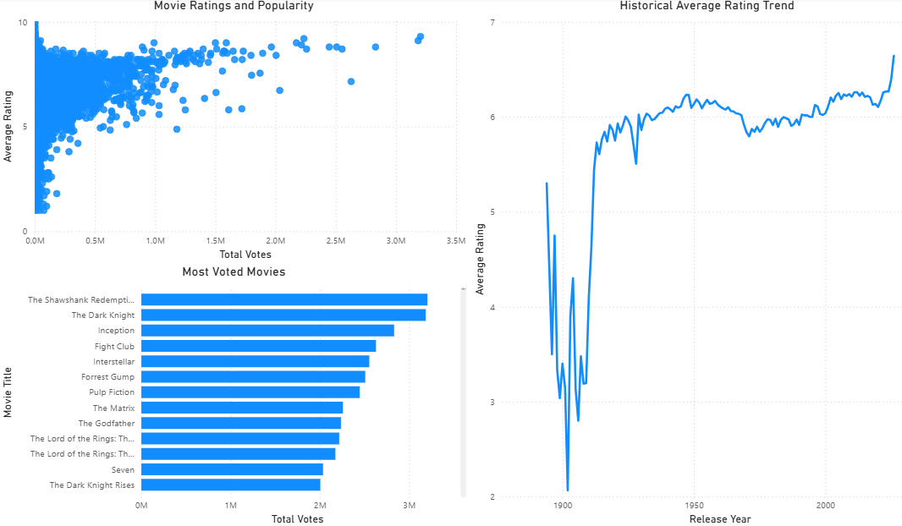
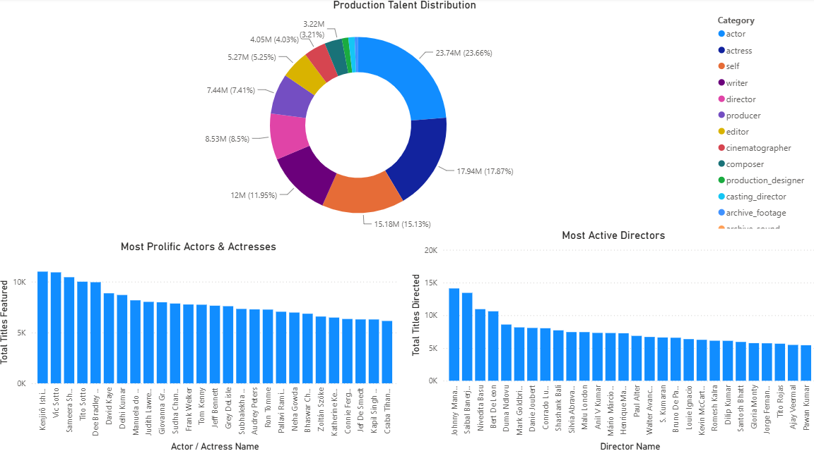
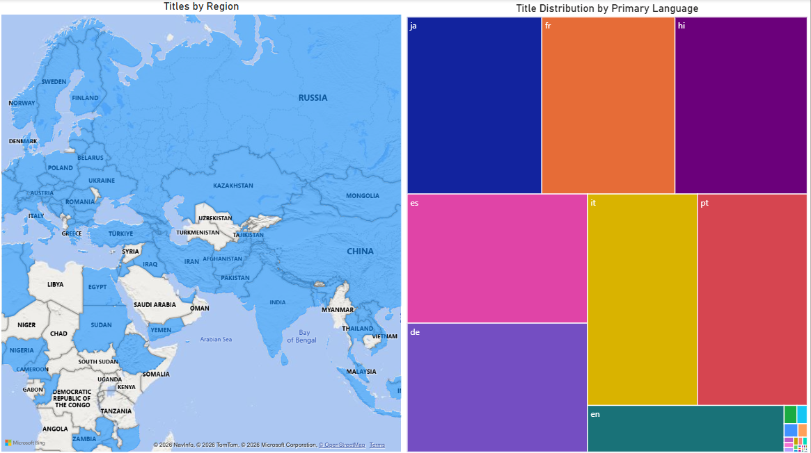

# imdb

>*This project explores the IMDb public datasets to better understand trends in film and television through data analysis and visualization.*


## Overview

This project analyzes the IMDb public datasets to explore patterns and trends across various content formats. The data is transformed and modeled to support analytical reporting, allowing users to examine title production trends, audience ratings, popularity, talent contributions, and global content distribution through interactive visualizations.

## Architecture



## Data Visualization

### 1. Industry Overview

Summarizes the overall scale of the IMDb dataset through key metrics, including total titles, average ratings, vote counts, and runtimes. It tracks annual release trends and analyzes format distribution, highlighting TV episodes as the dominant title type.



### 2. Content Evaluation

Explores audience perception and movie performance by examining the relationship between ratings and audience engagement based on voting activity. It highlights the most voted movies and analyzes rating trends across different release periods. The analysis provides insights into whether movies with higher audience engagement tend to achieve better ratings or whether popularity and perceived quality follow different patterns.



### 3. Talent Ecosystem

Focuses on the key figures behind and in front of the camera. It highlights the most prolific actors, actresses, and directors based on the number of titles they appeared in or directed.



### 4. Global Distribution

Examines the geographical distribution of titles across different regions and markets. It also explores the distribution of content by primary language, providing insights into global availability and language diversity.



## Data Source

This project uses publicly available datasets from [IMDb](https://datasets.imdbws.com/), covering title details, audience ratings, and industry personnel for analysis.

## Project Structure

```
imdb/
├── config/
├── dags/
│   ├── configs/
│   └── root/
├── imdb_analytics/
│   └── models/
├── plugins/
│   ├── generators/
│   └── models/
└── src/
```